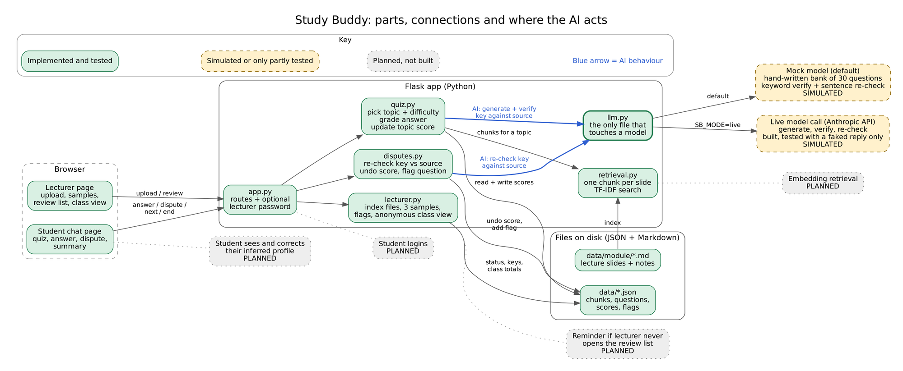
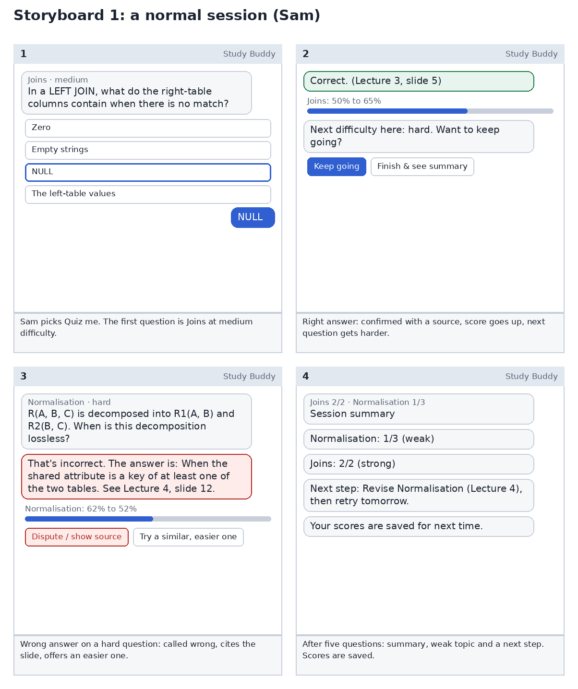
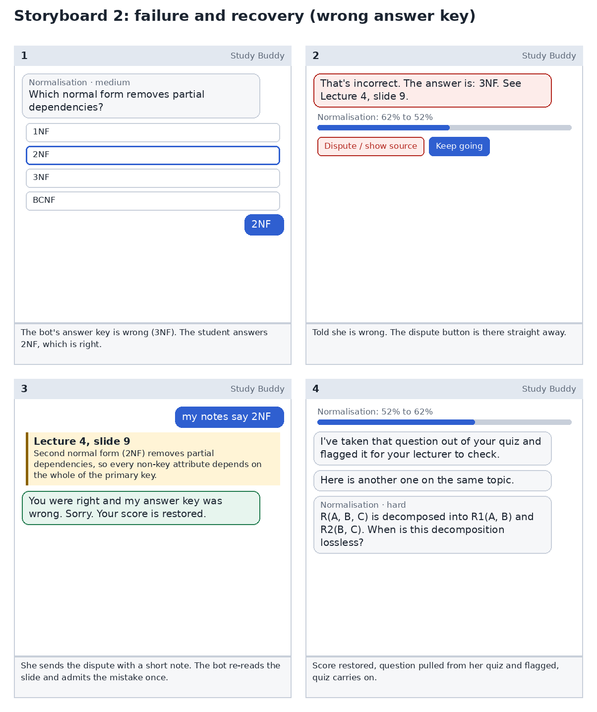
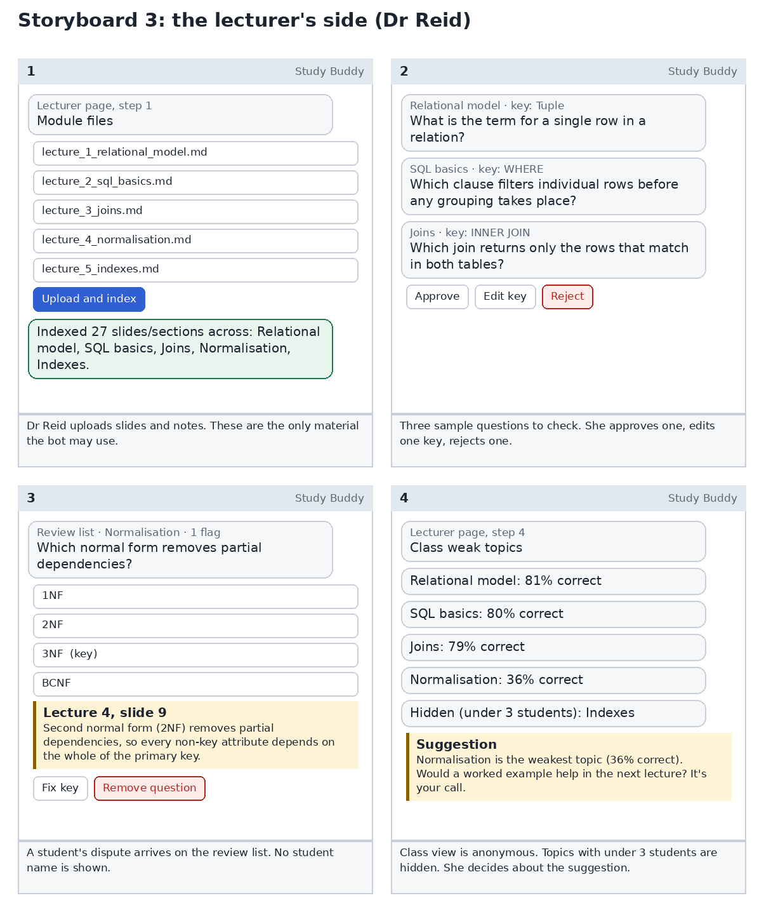

# Study Buddy

A quiz chatbot for one university module. It asks questions only from the lecturer's slides, adjusts difficulty from a score for each topic, and lets the student dispute an answer so the bot re-checks its own source.


## Project status

| Area | Status | Notes |
|---|---|---|
| Student chat: three modes, adaptive difficulty, topic scores, session summary | Works, tested | Quiz me, pick a topic, review weak topics |
| Dispute and recovery | Works, tested | Restores the score, pulls the question, flags it |
| Lecturer page | Works, tested | Upload, three samples, review list, anonymous class view, suggestion |
| Retrieval | Works | TF-IDF over one chunk per slide |
| Model in mock mode | Simulated | 30 hand-written questions. Question `nm5` has a deliberately wrong key (3NF, should be 2NF) so the failure can be replayed |
| Live mode | Written, not run for real | Tested only with a faked model reply, so question quality is unknown |
| Hosting support | Written, not deployed | Started under gunicorn locally |
| Not built | | Logins, more than one module, mobile layout, embedding retrieval, student profile editing, lecturer reminders, any study with real students |

## Technology stack

| Part | Choice | Why |
|---|---|---|
| Web app | Python 3 and Flask, two plain HTML and JavaScript pages | Small enough to run with no setup and to explain fully |
| Retrieval | TF-IDF in plain Python | Enough for one module, no extra packages |
| Data | JSON files. Sessions are held in memory | Simple. Not suited to many users |
| Model access | `sb/llm.py` only. `MockLLM` is the default. `LiveLLM` calls the Anthropic API using the standard library | Swapping mock for live changes one file. Model name comes from `SB_MODEL`, default `claude-sonnet-5-5` |
| Hosting and tests | gunicorn, pytest | |
| Report figures | Graphviz, Pillow | |

Still undecided: whether to move to SQLite or embeddings if more modules are added.

## Run it

```bash
pip install -r requirements.txt
python app.py
```

Then open http://127.0.0.1:5000 for the student page and http://127.0.0.1:5000/lecturer for the lecturer page. No API key is needed.

```bash
python -m pytest -q        # 14 tests, mock mode
python reset_demo.py       # restore the demo data
```

## Try the demo

1. Pick Sam, choose Quiz me, press Start. Answer a few questions and watch difficulty change.
2. Press "Demo: replay the wrong-key failure". Answer 2NF, then press "Dispute / show source".
3. Open the lecturer page. The flagged question is on the review list with no student name.
4. Check the class view. Indexes is hidden because only two students have answered it.

## Figures









The storyboards are drawn from the app's real responses. `python docs/make_figures.py` redraws them (needs Pillow).

## Live mode and API keys

1. Copy `.env.example` to `.env`.
2. Add your own `ANTHROPIC_API_KEY` and set `SB_MODE=live`.
3. Run `python app.py`.

`.env` is git-ignored, so never commit it. Without a key, live mode refuses to start instead of falling back to mock.

## Hosting

Set `SB_LECTURER_PASSWORD` (the username is `lecturer`) and run:

```bash
gunicorn wsgi:app --workers 1 --threads 4
```

Keep one worker, because sessions are in memory. `render.yaml` is a Render blueprint. Free hosting disks are temporary, so scores reset on each redeploy. Leave hosted copies in mock mode so nobody can spend your key.

## Project layout

```text
app.py            Flask routes
wsgi.py           gunicorn entry point
sb/retrieval.py   chunking and TF-IDF
sb/llm.py         mock and live model, the only file that calls a model
sb/quiz.py        topic and difficulty choice, grading, scores, summary
sb/disputes.py    dispute and recovery
sb/lecturer.py    upload, samples, review list, class view
templates/        student and lecturer pages
data/             chunks, questions, scores, flags, module files
seed/             clean copy of the demo data
docs/             diagram source and figures
tests/            acceptance tests T1 to T7 and extra checks
```

## Development record

| Stage | What changed | What was checked |
|---|---|---|
| 1 | Spec and storyboards from Labs 1 and 2, written before any code | Reviewed against the Assignment 1 literature |
| 2 | Module content, chunking, TF-IDF retrieval | Best-sentence lookup on the slide that holds the planted error |
| 3 | Mock question bank, quiz loop, scoring and difficulty | Scores and difficulty follow the spec's rules |
| 4 | Dispute path, storage, session summary | Score restored exactly, question pulled for that student |
| 5 | Lecturer page and class view | No student names in any lecturer response |
| 6 | Acceptance tests T1 to T7 | Found a replay hook that was ignored, two keys the verifier could not match, and "WHERE" wrongly treated as a stopword. Each was fixed and kept as a check |
| 7 | Live mode in `llm.py` | Faked reply only |
| 8 | Spec updated to match the build (section 12) | Compared against the code |
| 9 | Hosting support: gunicorn, lecturer password, data directory setting | Password test added. Started under gunicorn locally |

## AI assistance

I used Claude (Anthropic chat, Sonnet 5.5). I gave it my spec, Lab 1 and Lab 2 files and literature review, and asked it to build the project, then to draft the report, figures, README and hosting files. It wrote the code, tests and drafts. I checked them by running the 14 tests, syntax-checking both pages' JavaScript, starting the app under gunicorn, and looking at every figure. Several first drafts were wrong and were fixed, as the development record and `02_PROMPT_LOG.md` show. Not checked: live mode with a real key, and the pages in a browser.

To complete before submitting: add what you personally ran, changed or decided.

## Additional files

`01_SPEC.md` is the spec, updated to match the build. `02_PROMPT_LOG.md` lists the prompts. `seed/` is used by `reset_demo.py`. `docs/` holds the figures.
